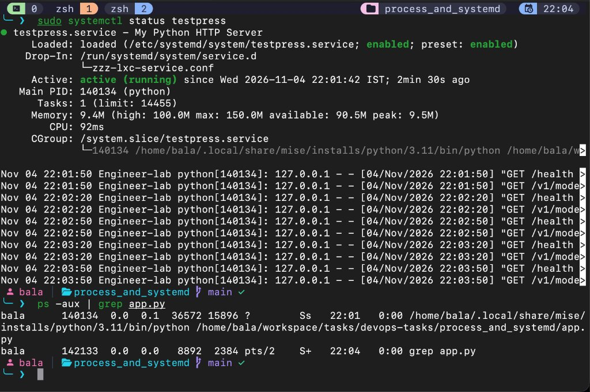
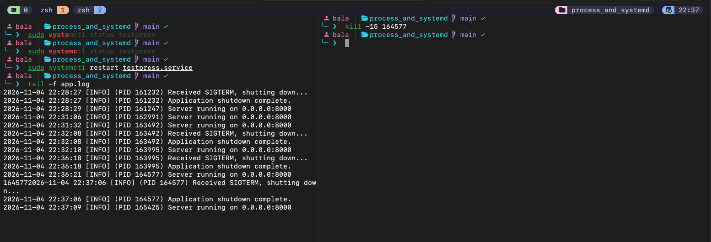
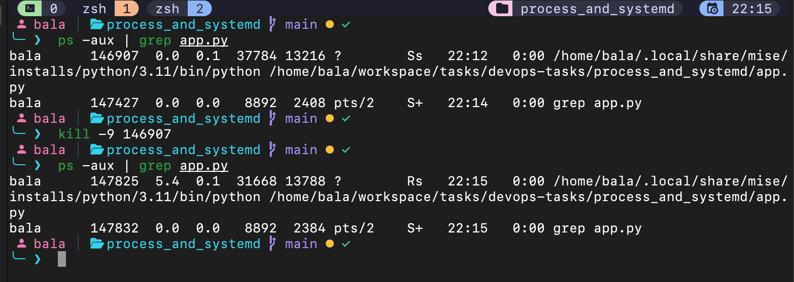
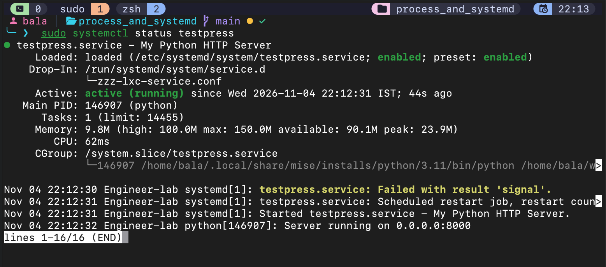
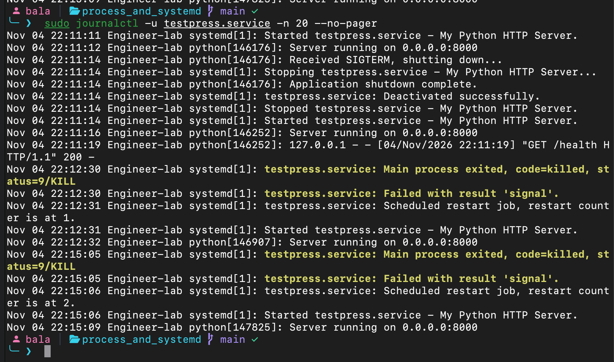
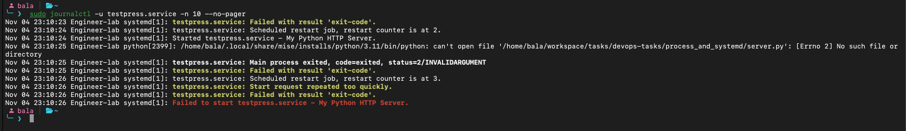
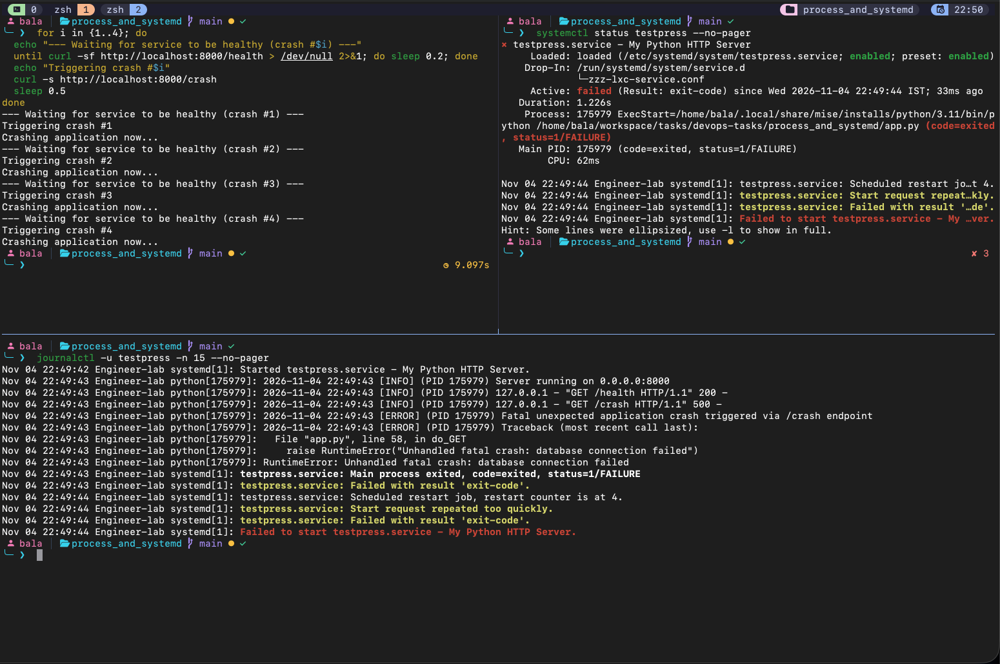
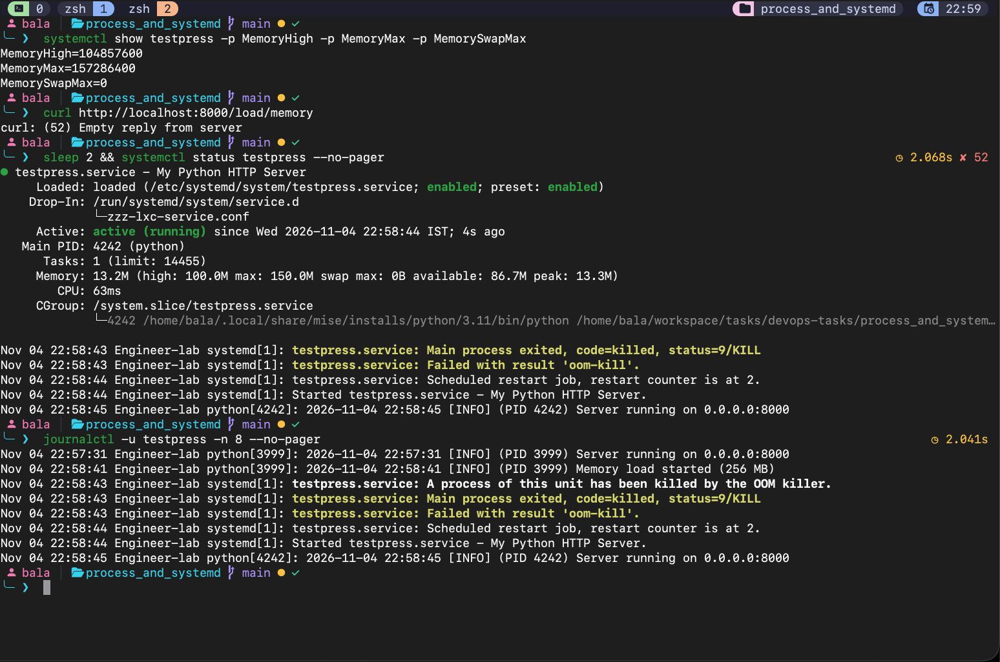
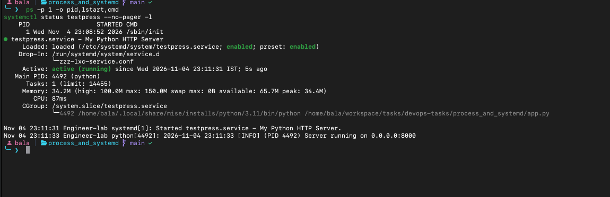

# What I learnt about Linux processes and systemd

I went through processes and daemons in Linux during this task. Even though I had used them before, I had never gone into this much depth about what happens behind the commands I use.

One new learning was what Ctrl+Z actually does. It does not kill the process: the terminal sends SIGTSTP to the foreground process group, which suspends it. The `kill` command can send signals other than termination signals too. I also learnt how `bg` resumes a suspended job in the background and `fg` brings it back to the foreground. Running something in the background is different from having a service manager look after it.

I came to understand systemd as the system and service manager, usually running as PID 1. It starts and supervises services, but other processes can also create child processes. `systemctl` is the command I use to interact with systemd; systemd itself handles automatic restarts.

For these experiments I used a Python HTTP app on port 8000. The endpoints involved in the tests were `/health` to check whether it was responding, `/crash` to make it exit with status 1, and `/load/memory` to allocate 256 MB. I ran it through `testpress.service`, which points to the Python executable and `app.py`.

## Exploring process commands

Before the systemd experiments, I learnt more about controlling a process from the terminal. These commands are useful for connecting the process state I see with what the application is doing.

### Suspending and resuming a job

This sequence shows the job-control behaviour I learnt about. Stop the service first so the manually started app can use port 8000.

```bash
sudo systemctl stop testpress
python3 app.py
# Press Ctrl+Z to suspend the app and return to the shell.
jobs
bg
jobs
fg
# Press Ctrl+C to shut down the app.
```

Ctrl+Z suspends the foreground job using SIGTSTP. `jobs` lists jobs managed by the current shell. `bg` resumes the suspended job in the background, while `fg` brings it back to the foreground. A background job can still print logs in the terminal. Ctrl+C sends SIGINT, which my app handles with a graceful shutdown.

### Finding and inspecting processes

I already used `ps -aux | grep app.py` in the experiments below. These are other commands to explore and add observations for after running them:

```bash
pgrep -af app.py
pidof python3
pstree -p
top
htop
```

`pgrep` searches process names or command lines; `-f` matches the full command line and `-a` prints it. `pidof` searches by executable name, so its argument may need to be `python` instead of `python3`, depending on how the app was started. `pstree` shows parent and child relationships. `top` and `htop` show live process and resource information; press `q` to exit. `htop` may need to be installed separately.

### Signals, terminal logout, and priority

The service experiments below document `kill -15` and `kill -9`. The following commands are additional practice, not recorded results yet. Use a manually started app with the service stopped.

```bash
nohup python3 app.py > /tmp/testpress-nohup.log 2>&1 &
jobs
pgrep -af app.py
```

`nohup` makes the command ignore SIGHUP and redirects its output here to a file. It does not provide automatic restart or boot startup. To explore `pkill`, first confirm the intended app process with `pgrep`, then send SIGTERM using the same pattern:

```bash
pgrep -af 'python3 app.py'
pkill -TERM -f 'python3 app.py'
```

After trying these commands, I still need to add my actual observations, including anything that behaved differently from what I expected.

## 1. Finding the running process

I ran `systemctl status testpress` and `ps -aux | grep app.py`. At first I thought I should search for `testpress`, because that was the service name. The process listing showed Python running `app.py` instead. This helped me understand that the service unit name and the command it starts are different things.

The screenshot shows PID 140134 in both outputs. The extra `grep app.py` entry is the search command itself.



## 2. Sending SIGTERM

I sent `kill -15 164577` while watching `app.log` with `tail -f app.log`. The application logged that it received SIGTERM, followed by “Application shutdown complete.” It then started again with a new PID.

This showed me that SIGTERM gives the application a chance to handle shutdown. My handler exits with status 0 and the cleanup code closes the server. The service still restarted because I configured `Restart=always`, which also covers clean exits. An explicit `systemctl stop testpress` stops the service without triggering this automatic restart.



## 3. Sending SIGKILL and watching the restart

I checked the service process using `ps -aux | grep app.py`, sent `kill -9 146907`, and checked again. The original PID was 146907 and the replacement was 147825.

`kill -9` sends SIGKILL, which cannot be caught by the application. It terminates the process without letting its shutdown handler or cleanup code run. Unlike the SIGTERM test, the application does not get a chance to shut down gracefully.

The changed PID showed that systemd started a replacement process after the original was killed. My unit has `Restart=always`, so systemd handles this recovery automatically. This helped me understand that killing the process is different from stopping the service with `systemctl stop testpress`.



## 4. Checking the systemd service

I used `sudo systemctl status testpress`. It showed `active (running)`, the main Python PID, its cgroup, memory usage, and recent logs. It also showed that the service was enabled.

I learnt that running and enabled tell me different things. Running describes the current state, while enabled means the service has been connected to a startup target so it can start during boot. The output also showed a previous failure followed by a scheduled restart.



## 5. Investigating with journald

I ran `sudo journalctl -u testpress.service -n 20 --no-pager`. The logs showed `status=9/KILL`, the failed result, a scheduled restart, and the application starting again.

I learnt that `systemd-journald` is a separate daemon that collects logs. `journalctl` lets me read them, and `-u` filters them to a particular service. This gives me more context than just seeing whether the process is currently running: I can follow the failure and restart sequence. The application's standard output reaches the journal through systemd's default logging setup.



## 6. A wrong application path

For the invalid-path test, the service referred to `server.py`, which did not exist. I inspected the result with `sudo journalctl -u testpress.service -n 10 --no-pager`.

Python reported that it could not open `server.py`, and systemd recorded exit status 2. After retries, the journal showed “Start request repeated too quickly.” This helped me see why the actual error message matters: restarting cannot fix a path that is wrong.

This screenshot demonstrates a missing script path. The Python executable itself still started, so this differs from the task's specific invalid-executable experiment. That experiment, along with a failed-service status screenshot, still needs to be captured separately.



## 7. Repeated crashes and restart limits

I used a loop to wait for `/health` and then call `/crash` repeatedly. The application exited with status 1. The service status and journal eventually showed “Start request repeated too quickly,” and the service stayed failed.

This showed me that automatic restart does not mean unlimited immediate retries. The unit contains `RestartSec=1`, `StartLimitIntervalSec=15s`, and `StartLimitBurst=3`. These settings add a delay between restarts and limit how many starts are allowed in the time window.

The traceback-looking message from `/crash` is simulated text in the application. The actual failure used in this experiment is `os._exit(1)`; no real database connection failed.



## 8. Exceeding the memory limit

I checked the limits with `systemctl show testpress -p MemoryHigh -p MemoryMax -p MemorySwapMax`, then called `curl http://localhost:8000/load/memory`. The unit has a 100 MB memory high threshold, a 150 MB maximum, and no swap allowance. It also has `CPUQuota=5%` configured.

The endpoint tried to allocate 256 MB. The request returned an empty reply, and the journal reported that a process in the unit had been killed by the OOM killer. The service result was `oom-kill`, followed by an automatic restart.

This made resource limits clearer to me. `MemoryHigh` is a pressure threshold, while `MemoryMax` is the hard limit. The kernel enforced the memory limit and killed the process; systemd then restarted the application according to the service policy. `systemctl` let me inspect what happened. I configured the CPU limit, but this screenshot demonstrates the memory test rather than CPU throttling.



## 9. Checking startup after a machine restart

When checking boot persistence in OrbStack, I first tried `uptime -s`. The time did not change as I expected. I learnt that OrbStack machines share a kernel, so its boot time can stay unchanged when an individual Linux machine restarts.

I then used `ps -p 1 -o pid,lstart,cmd` alongside `systemctl status testpress --no-pager -l`. The screenshot shows PID 1 starting at 23:08:52 and the enabled service running since 23:11:31.

Enabling a service allows systemd to start it during boot through its configured target. However, this screenshot alone does not prove automatic startup: there is a gap between the two times, and the image does not show what happened in between. To finish verifying this, I need to restart the machine with the correct unit already enabled, then check its status and startup logs without manually starting or restarting the service.



## What I took away

Before this task, I mostly used these commands to get something running or stop it. Now I have a better understanding of suspending a job, shutting down a process gracefully, forcibly killing it, and letting systemd manage its lifecycle.

The memory experiment connected these ideas for me: the application exceeded its limit, the kernel killed it, systemd brought it back, and the journal explained the sequence. I also learnt to check the reason for a failure instead of repeatedly restarting a service and hoping that it works.
